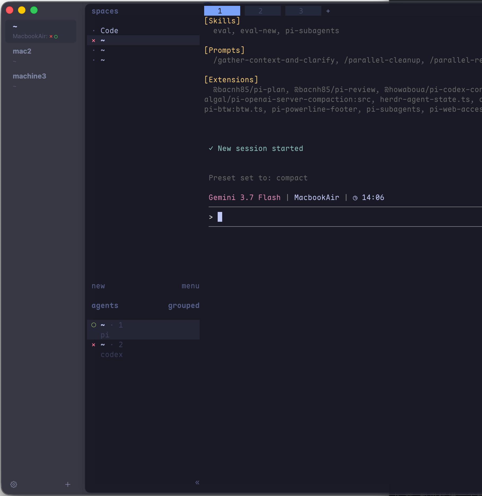

# MuH (Multiplexing Host Manager)

<p align="center">
  <strong>超轻量、高性能的 macOS 原生多机 Agent 终端管理器</strong><br>
  <em>搭配 Herdr，让多台机器上的数十个 AI Agent 状态与提醒尽收眼底</em>
</p>

<p align="center">
  
  
  
  
  
</p>

<p align="center">
  
</p>

---

## 💡 为什么需要 MuH？

在 AI Coding 时代，开发者常常需要在**多台机器**上并行运行多个 AI Agent（例如：本地 Mac 跑前端、`dev1` 跑模型微调、`dev2` 跑测试套件）。

传统工具的痛点：
- **单机 Multiplexer（Tmux / 单机 Herdr）**：无法跨机器聚合状态，你必须反复在多个窗口间来回切换，肉眼排查哪个 Agent 卡住、哪个跑完。
- **传统 GUI 终端（iTerm2 / Warp / Ghostty）**：缺乏 Agent 语义感知，无法在侧边栏呈现多机全景状态。
- **Web 看板**：需要每台机器开放端口、配置反向代理，运维极重且与本地终端操作割裂。

**MuH** 带来了全新解决方案：**1 Host = 1 个全屏 Ghostty 终端（运行 Herdr）**。MuH 作为 macOS 顶层 Host 容器，通过极简的 PTY 终端标题通道（OSC 0），将多台机器中数十个 Agent 的实时生命体征聚合在左侧边栏，并提供原生的系统横幅与声音提醒！

---

## ✨ 核心特性

### 1. 🌐 多机 Agent 全景看板
* **一目了然的生命体征（符号数量 = 存活 Agent 数量）**：侧边栏实时呈现各 Host 的 Agent 状态符号：
  * <font color="#f87171">🔴 **`×`**</font> **阻塞 / 需要人类介入确认**（`blocked`，高优排在最前）
  * <font color="#4ade80">🟢 **`✓`**</font> **完成待查看**（`done`）
  * <font color="#fbbf24">🟡 **`◐`**</font> **正在执行中**（`working`）
  * <font color="#4ade80">🟢 **`○`**</font> **活着但处于待命空闲状态的 Agent**（`idle`）
  * 当 Host 上 **0 个 Agent 存活**时，自动显示纯净文本 `hostname: idle`（零符号）。
* **点击直达**：点击任意 Host，终端瞬间平滑切换至该机器。

### 2. ⚡️ 纯 PTY 穿透，零网络配置开销
* 状态数据直接搭载在标准的 PTY 终端窗口标题（OSC 0）流中传输。
* **零额外监听端口、零反向代理、自然穿透 SSH**。只要 SSH 能连通，状态就能 100% 毫秒级回传到 Mac。

### 3. 🔔 macOS 原生智能系统通知与声音提醒
* **精准事件触发**：当任意远程机器的 Agent 遇到阻塞（`×`）或所有任务完成（`✓`）时，MuH 发送 macOS 原生横幅通知并播放清脆音效。
* **点击通知秒切 Host**：在任何全屏应用或桌面下点击通知，MuH 自动置顶并聚焦到对应的主机。
* **丰富音效库**：内置 14 款 macOS 经典系统提示音（`Glass`, `Ping`, `Hero`, `Pop`, `Bottle` 等），支持在设置中一键试听。

### 4. 🚀 极致性能与极简架构
* **Ghostty GPU 加速**：内嵌 `libghostty` 原生渲染引擎，享受极致流畅的金属级终端渲染。
* **职责清晰分层**：MuH 专注于多机管理与全局通知；单机内部的多 Pane / Tab 复用与 Agent 调度 100% 委托给 **Herdr v0.8.2**。
* **纯净工程**：零 SPM 外部依赖，纯原生 Swift / SwiftUI + XcodeGen 架构，极速秒级构建。

### 5. 🎨 现代 macOS 精致桌面美学
* **可拖拽侧边栏（Resizable Sidebar）**：支持 150pt ~ 360pt 自由拖拽调节宽度，双击分界线快速复位，偏好自动持久化。
* **物理卡片分界**：终端区采用独立沉浸式卡片容器设计，配合精致边框与投影，层次分明。
* **完美符号排版**：采用 Menlo 原生等宽字形与专属字间距（Kerning），符号高度与基线绝对平齐。
* **完整中英文国际化**：随系统或应用内语言切换即时生效。

---

## 🛠 快速上手

### 1. 本地安装与启动

```bash
# 克隆仓库
git clone https://github.com/tangxijin/MuH.git ~/Code/MuH
cd ~/Code/MuH

# 一键构建并启动
./restart.sh
```

MuH 的 Ghostty vendor 构建使用固定的 Ghostty revision 和兼容的 Zig 版本，首次构建前请确保已安装 Zig `0.16.0` 或兼容的 `0.16.x` 补丁版本，然后运行：

```bash
./scripts/build-vendor.sh
```

修改 Herdr 插件后，使用下面的命令重新生成远程初始化脚本中的嵌入版本：

```bash
./scripts/generate-setup-herdr.sh
```

### 2. 远程主机一键初始化（配置 Herdr 状态插件）

在新添加的远程服务器上，只需在 Mac 本地执行一行命令即可完成 Herdr 插件的自动部署与状态同步：

```bash
ssh <user@host> 'bash -s' < ~/Code/MuH/Resources/scripts/setup-herdr.sh
```

*(也可以在 MuH 的「设置 ➔ 提醒」中点击“拷贝初始化命令”)*

---

## ⌨️ 常用快捷键

| 快捷键 | 功能 |
| :--- | :--- |
| `⌘ + ,` | 打开 / 关闭设置面板 |
| `⌘ + N` | 新建 Host（默认 `~` 原生终端） |
| `⌘ + 1` ~ `⌘ + 9` | 快速切换到第 1 ~ 9 个 Host |
| `⌘ + C` / `⌘ + V` | 终端复制 / 粘贴 |
| `⌘ + A` | 终端全选 |

---

## 🙏 致谢与致敬 (Acknowledgments)

本项目深受开源项目 **[mux0](https://github.com/10xChengTu/mux0)** 的启发，并复用了其部分优秀的 UI 设计模式与 Ghostty C Bridge 核心基础代码。在此向 `mux0` 的作者与贡献者们致以诚挚的感谢！

在此基础上，MuH 进行了全面革新：
- 将内部 Tab/Split 多路复用解耦并全面委托给 **Herdr v0.8.2**；
- 首创基于 PTY OSC 0 窗口标题的多机 Agent 状态穿透与聚合体系；
- 引入了 macOS 原生智能事件通知、声音管理、可拖拽侧边栏与自包含远程部署能力。

---

## 📄 开源许可证

本项目采用 [MIT License](LICENSE) 许可证。
